<b>🇲🇽 Desarrollo apps web y móviles, del primer pixel al deploy.</b> 
<i>🇺🇸 I build web & mobile apps, from the first pixel to deploy.</i>

 

| 🇲🇽 Español | 🇺🇸 English |
|---|---|
| 🕹️ Construyo backends con **Node.js / Express** y **Laravel**, y frontends con **Angular** y JavaScript puro. | 🕹️ I build backends with **Node.js / Express** and **Laravel**, and frontends with **Angular** and vanilla JS. |
| 📱 Hago apps móviles con **Flutter**. | 📱 I make mobile apps with **Flutter**. |
| 🗄️ Me llevo bien con bases de datos relacionales (**Oracle**, MySQL). | 🗄️ Comfortable with relational databases (**Oracle**, MySQL). |
| 👾 Fan del pixel art y la estética retro: si tiene 8 bits, me interesa. | 👾 Pixel art & retro fan: if it's 8-bit, I'm in. |
| 📚 Siempre con algún curso en marcha fuera del horario laboral. | 📚 Always running a side course after hours. |

 

 

<table>
<tr>
<td width="50%" valign="top">

🇲🇽 Sistema de reservaciones con Laravel y frontend en TypeScript + Vite. 🇺🇸 Booking system built with Laravel and a TypeScript + Vite frontend.
</td>
<td width="50%" valign="top">

🇲🇽 App móvil en Flutter enfocada en la prevención de la violencia. 🇺🇸 Flutter mobile app focused on violence prevention.
</td>
</tr>
<tr>
<td width="50%" valign="top">

🇲🇽 Votaciones en tiempo real para torneos entre amigos: voto secreto, resultados animados y modo estrellas. 🇺🇸 Real-time voting for friend tournaments: secret votes, animated live results and a star-rating mode.
</td>
<td width="50%" valign="top">

🇲🇽 Web app en Angular desplegada en Vercel · <a href="https://kallix-studio.vercel.app">demo</a>. 🇺🇸 Angular web app deployed on Vercel · <a href="https://kallix-studio.vercel.app">demo</a>.
</td>
</tr>
</table>

 

 

